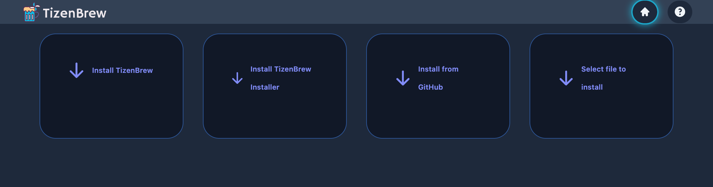
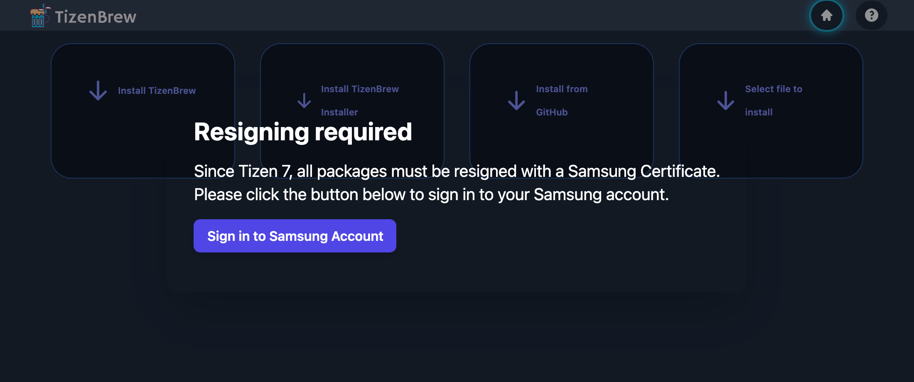

<p align="center">
  
</p>

<p align="center">
  Filmes e séries na TV Samsung, só com o controle remoto.<br>
  <sub>Projeto experimental, para uso pessoal.</sub>
</p>

O Freeflix é um app para **TV Samsung (Tizen)** que reúne um catálogo de filmes e séries e
toca o vídeo que addons de terceiros oferecem para cada título. Abre direto no catálogo:
sem login, perfil ou conta. Também funciona no navegador do computador e do celular.

- **Continuar assistindo** de onde parou, com o próximo episódio pronto.
- **Várias fontes ao mesmo tempo**: o app compara as opções (resolução, áudio) e toca a
  melhor; se falhar, tenta a seguinte.
- **Legendas** em português, inglês e espanhol.
- **Sincroniza entre as TVs da casa** com um código de 6 números, sem e-mail.

> [!WARNING]
> **Aviso legal.** O Freeflix é apenas um reprodutor e organizador de streams HTTP. Ele
> não hospeda, armazena, envia nem distribui nenhum vídeo. Catálogo, fontes e legendas
> vêm de serviços de terceiros, que o app só consulta. O projeto não controla esses
> serviços e não se responsabiliza pelo conteúdo deles nem pela disponibilidade das
> fontes. Cabe a quem usa garantir que tem o direito de acessar o que assiste, conforme a
> lei do seu país.

## Instalar na TV Samsung

Serve para TV Samsung de 2017 em diante. Você vai precisar de um computador (Windows, Mac
ou Linux) na **mesma rede** da TV. A instalação é feita pelo **TizenBrew Installer**, um
programa que roda no computador e manda o app para a TV.

TVs mais novas (Tizen 7+, em geral 2023 em diante) pedem também login numa **conta
Samsung** (grátis). Não precisa descobrir a versão: o Installer vê sozinho e só pede se
for preciso.

### 1. Baixar os dois arquivos

- O app: **[Freeflix.wgt](https://github.com/thomaskauai/freeflix/releases/latest/download/Freeflix.wgt)**
- O [TizenBrew Installer](https://github.com/reisxd/TizenBrewInstaller/releases/latest)
  do seu sistema: `TizenBrewInstaller-win-x64.exe` (Windows),
  `TizenBrewInstaller-macos-arm64` (Mac M1/M2…), `TizenBrewInstaller-macos-x64` (Mac
  Intel) ou `TizenBrewInstaller-linux-x64` (Linux).

### 2. Ligar o modo de desenvolvedor na TV

1. Descubra o IP do computador. Windows: `ipconfig` no Prompt de Comando, "Endereço
   IPv4". Mac: `ipconfig getifaddr en0` no Terminal. Algo como `192.168.0.10`.
2. Na TV, abra **Apps** e digite **`1 2 3 4 5`** no controle (controle sem números:
   aperte o botão **`123`** para abrir o teclado na tela).
3. Na janela **Developer Mode**: ligue (**On**), digite o IP do computador em **Host PC
   IP** e confirme.
4. **Reinicie a TV segurando o botão liga/desliga** até aparecer o logo da Samsung (só
   desligar e ligar não serve).

Anote o **IP da TV**: Configurações → Geral → Rede → Status da rede → Config. IP.

### 3. Abrir o Installer e conectar

- **Windows**: dois cliques no `.exe`. Se o Windows bloquear: **Mais informações →
  Executar assim mesmo**.
- **Mac / Linux**: no Terminal, na pasta do download:

  ```bash
  chmod +x TizenBrewInstaller-macos-arm64
  xattr -d com.apple.quarantine TizenBrewInstaller-macos-arm64   # só no Mac
  ./TizenBrewInstaller-macos-arm64
  ```

Abre uma página no navegador (se não abrir: `http://localhost:8091`). Deixe o programa
aberto até o fim. Em **Connect to TV**, digite o **IP da TV** e aperte Enter:


### 4. Instalar

Conectado, aparecem quatro botões. Clique em **Select file to install** (o último) e
escolha o `Freeflix.wgt`:



**Se aparecer "Resigning required"** (TVs Tizen 7+): clique em **Sign in to Samsung
Account**, entre na sua conta Samsung na página que abrir, volte ao Installer e clique de
novo em **Select file to install**.



Quando aparecer **Package installed**, está pronto: o Freeflix fica em **Apps** na TV.
Para pô-lo na tela inicial, selecione o ícone, segure OK e escolha **Adicionar à Início**.

Não precisa clicar em **Install TizenBrew**: é outro app, não é necessário para o
Freeflix.

### Atualizar

Baixe o `Freeflix.wgt` novo e repita os passos 3 e 4. Nada do que você assistiu se perde.
Deixe o modo de desenvolvedor ligado na TV para isso. Em TV Tizen 7+, entre sempre com a
**mesma conta Samsung** (o Installer pede o login a cada instalação; é normal).

### Deu erro?

| Mensagem | O que fazer |
|---|---|
| *Make sure that the TV is on and that the IP is correct* | IP da TV errado, TV desligada, ou TV e computador em redes diferentes (ex.: Wi-Fi de visitantes). |
| *Either you haven't set the Host PC IP… or you didn't restart the TV properly* | Refaça o passo 2: confira o IP do computador (pode mudar de um dia para o outro) e reinicie segurando o botão liga/desliga. |
| Conectou uma vez e depois não conecta mais | Feche o Installer, abra de novo e reconecte. |
| *Author certificate not match* | O app foi instalado antes com outra conta Samsung. Desinstale o Freeflix na TV (segure OK no ícone → Excluir) e instale de novo. |

## Usando

| Ação | Controle da TV | Teclado |
|---|---|---|
| Mover | setas | setas |
| Selecionar | OK | Enter |
| Voltar | Back | Esc |
| Reproduzir / pausar | Play/Pause | Espaço |
| Avançar / voltar (segurar acelera) | FF / RW | → / ← |

**Sincronizar entre TVs:** em Configurações → Sincronizar entre TVs, escolha **Criar
código** e leia o QR code com o celular; ele mostra o código da casa (6 números). Nas
outras TVs, **Já tenho um código** e digite os números. A partir daí todas compartilham o
"Continuar assistindo" e o que já foi visto.

**Fontes:** já vêm configuradas e se atualizam sozinhas. Em Configurações dá para
remover alguma ou adicionar outra pelo link do `manifest.json` do addon.

## Avançado: código-fonte

Para usar não precisa disso. Rodar no computador, editar o código, gerar o `.wgt` e como
o app funciona por dentro estão em [DESENVOLVIMENTO.md](DESENVOLVIMENTO.md).
